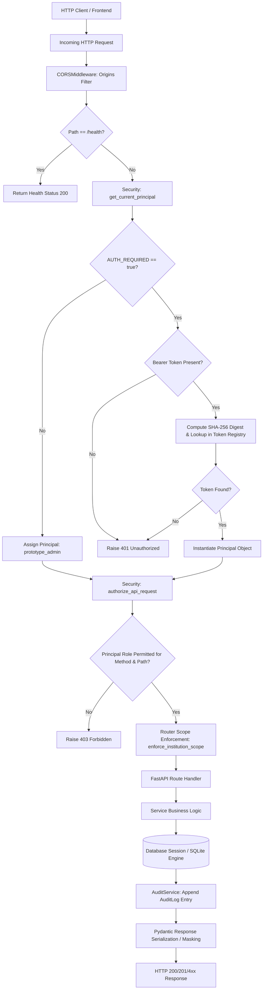

# PRAMAAN / APAAR Sentinel — Phase 1: Comprehensive Backend Audit & Architectural Assessment

**Project:** PRAMAAN / APAAR Sentinel  
**Problem Statement:** AICTE Hackathon SIH26263  
**Audit Phase:** Phase 1 — Comprehensive Inspection, Requirements Mapping & Security Audit  
**Target Environment:** Python 3.11+ / FastAPI / SQLAlchemy 2.0 / Pydantic v2 / Alembic / SQLite  
**Auditor Roles:** Senior Python Backend Architect, FastAPI Engineer, Database Engineer, Application Security Specialist, AI Systems Engineer  
**Audit Execution Date:** October 2026  
**Deliverable Path:** `backend/BACKEND_AUDIT_PHASE1.md`  

---

## 1. Executive Summary

### 1.1 Overview & System Purpose
**PRAMAAN / APAAR Sentinel** is an institutional data governance, enrolment integrity, temporal conflict detection, and compliance platform engineered for AICTE-approved institutions and higher educational regulatory oversight. The system addresses critical vulnerabilities in higher technical education data management: ghost enrolments, overlapping concurrent regular degree registrations across multiple institutions, approved-intake over-capacity violations, irregular quota admissions, and unverified academic credential fraud.

### 1.2 Audit Scope & Methodological Integrity
This Phase 1 backend audit performed an exhaustive, evidence-based code and schema inspection across all backend modules (`backend/app/`, `backend/tests/`, `backend/migrations/`, `backend/requirements.txt`, `backend/alembic.ini`, `backend/.env.example`, and the live database `backend/apaar_sentinel.db`). 

In strict adherence to the Phase 1 non-destructive execution protocol:
1. **Zero application modifications:** No application code, frontend code, configuration, or dependencies were altered.
2. **Zero database mutations:** Database inspection was performed using safe, read-only connections (`file:backend/apaar_sentinel.db?mode=ro`). No migrations were executed.
3. **Execution safety limitation:** As identified in Section 1.4 and Section 7, the legacy automated test suite includes test files (`test_api_endpoints.py`, `test_additional_features.py`) that instantiate `TestClient(app)` directly against the live prototype database file (`apaar_sentinel.db`) without in-memory or fixture-level database overrides. Executing the full pytest suite in this state would alter or pollute live demo database records. Consequently, live test execution was restricted to read-only static analysis and AST inspection.
4. **Source of Truth Clarification:** The workspace was searched for external presentation slides (`.pptx`, `.pdf`) and standalone research report documents. These external binary files were **not present in the workspace**. Intended requirements were established strictly from authoritative workspace documents: `PROJECT_STATUS.md`, root `README.md`, `backend/README.md`, and application source code. All references to promised vs. implemented capabilities are grounded exclusively in verified code artifacts.

### 1.3 State of Implementation
The backend implementation exhibits high-quality domain architecture in several core subsystems, but remains an early-stage prototype with significant gaps between conceptual research claims and actual code:

- **What is Implemented and Working:**
  - **Temporal Integrity Engine (`app/services/integrity_engine.py`):** Successfully evaluates pairwise student enrolment intervals, distinguishing legitimate chronological transfers (Scenario A), concurrent active regular enrolments (Scenario B), and documented permitted regulatory exceptions (Scenario C).
  - **Pre-Ingestion Validation Centre (`app/services/validation_service.py`):** Robust schema and data-hygiene validation covering mandatory attributes, ISO-8601 formatting, chronological inversion, status enums, and batch duplicate detection.
  - **Intake Compliance Engine (`app/services/intake_service.py`):** Strictly isolates single-cycle new admissions from multi-cohort active student bodies, preventing the false over-intake alarms that plague naive aggregations. Compares regular intake, Supernumerary-TFW, and NRI quotas independently without invalid quota summing.
  - **Case Review Workflow & History (`app/models/review_event.py`, `app/routers/alerts.py`):** Enforces a strict status transition state machine (`OPEN` -> `UNDER_REVIEW` -> `RESOLVED`), requiring explicit reopening justifications for resolved cases, with an append-only review event ledger.
  - **CSV Batch Ingestion with Provenance (`app/services/csv_import_service.py`):** Enforces 10 MiB / 10,000-row limits, computes HMAC identity hashes for deduplication, records job and row-level results (`ImportJob`, `ImportRowResult`), and performs partial-success ingestion.
  - **Role-Based Authorization & Scoping (`app/security.py`):** Provides role-based access control (`administrator`, `institution_officer`, `reviewer`, `read_only_auditor`, `external_verifier`) with institution-scoped data isolation and identifier masking for non-admin principals.
  - **Cryptographic Credential Verification Prototype (`app/services/certificate_service.py`):** Implements HMAC-SHA256 signature verification, constant-time comparison, tamper detection, and revocation gates.
  - **DPDP Consent-Gated Employer Verification (`app/services/verifier_service.py`):** Gates credential checks behind active, purpose-specific student consent records under Digital Personal Data Protection (DPDP) principles.

- **What is Incomplete, Simulated, or Missing:**
  - **Fuzzy Entity Resolution & Identity Linkage:** No probabilistic record linkage, fuzzy name matching, phonetic indexing, or candidate review queues exist. Matching is strictly exact string comparison on `student_ref` or `apaar_id`.
  - **"APAAR-Fuse" Machine Learning Models:** No neural, graph, or trained ML models (e.g., CatBoost, GNNs) exist in the codebase. Anomaly detection consists of deterministic statistical formulas (Z-scores and peer IQR).
  - **Live External Integrations:** External systems (APAAR / ABC Registry, DigiLocker, UDISE+, AICTE Approval Portal) are completely unintegrated. APAAR IDs are treated as local database strings without upstream validation.
  - **Cryptographic Asymmetric Infrastructure:** Credential signing uses a single shared symmetric secret (`SECRET_KEY`) with HMAC-SHA256 rather than asymmetric public-key cryptography (ECDSA/Ed25519). Public verification without exposing the signing key is impossible in this model.
  - **Student Record Mutation API:** No endpoint exists to update student profile data (`PUT`/`PATCH /api/v1/students/{student_ref}`).
  - **Rate Limiting & Dynamic Auth:** No rate-limiting middleware exists. API authentication relies on static SHA-256 tokens in an environment variable with no dynamic user login, JWT lifecycle, or session expiration.

### 1.4 Critical Risks & Architectural Gaps
1. **Live Database Pollution by Automated Tests:** Test files directly write to `apaar_sentinel.db` during test runs.
2. **Symmetric Signing Security Risk:** The credential system cannot be distributed to public verifiers without exposing the private HMAC signing secret.
3. **Database Migration Desynchronization:** Core database tables were created via SQLAlchemy `create_all()` without Alembic migration history; the live database file lacks the `alembic_version` tracking table and the composite duplicate lookup index.
4. **Hardcoded Non-Nullable Identifier Constraint:** `Student.apaar_id` is strictly `nullable=False, unique=True`, preventing ingestion of pre-APAAR historical student records or international students without synthetic APAAR identifiers.
5. **Unauthenticated Anomaly Dismissal:** `PATCH /api/v1/analytics/anomalies/{anomaly_id}/dismiss` lacks principal-bound authorization, allowing arbitrary caller spoofing.

---

## 2. Architecture Map

### 2.1 Component Topology & Directory Structure

```
anayava/backend/
├── alembic.ini                         # Alembic database migration configuration
├── requirements.txt                    # Pinned and version-bounded Python dependencies
├── apaar_sentinel.db                   # SQLite demonstration database
├── migrations/
│   ├── env.py                          # Alembic migration runner environment
│   └── versions/
│       ├── 20261023_01_alert_review_events.py           # Review event history table
│       ├── 20261024_01_import_job_history.py            # CSV import job & row tables
│       └── 20261026_01_enrolment_duplicate_lookup_index.py # Composite duplicate lookup index
└── app/
    ├── config.py                       # Settings, environment guards, token registry
    ├── database.py                     # SQLAlchemy engine, session maker, get_db dependency
    ├── security.py                     # Principal models, bearer auth, RBAC, scoping, masking
    ├── admission_categories.py         # Category enums, normalizers, and quota sets
    ├── seed_data.py                    # Idempotent synthetic demonstration data generator
    ├── main.py                         # FastAPI application entrypoint, middleware, router mounts
    ├── models/                         # SQLAlchemy ORM Data Models
    │   ├── student.py                  # Student profile & alternative identity routes
    │   ├── enrolment.py                # Academic enrolment records & temporal bounds
    │   ├── alert.py                    # Integrity alerts, evidence, reviewer decisions
    │   ├── review_event.py             # Append-only case review audit trail
    │   ├── audit.py                    # Global system-wide audit event ledger
    │   ├── intake.py                   # Approved intake quotas & historical baseline
    │   ├── certificate.py              # Signed academic credential records
    │   ├── consent.py                  # Student DPDP verification consent records
    │   ├── verifier.py                 # External verifier organizations & request logs
    │   ├── versioning.py               # Enrolment revision diffs
    │   └── import_job.py               # Persistent CSV import jobs & row outcomes
    ├── schemas/                        # Pydantic v2 Request/Response DTOs
    │   ├── student.py                  # StudentBase, StudentCreate, StudentResponse
    │   ├── enrolment.py                # EnrolmentBase, EnrolmentCreate, EnrolmentResponse
    │   ├── alert.py                    # AlertReviewRequest, Assignment, Notes, AlertResponse
    │   ├── intake.py                   # ApprovedIntakeRuleRequest
    │   └── dashboard.py                # DashboardSummaryResponse
    ├── services/                       # Business Logic Layer
    │   ├── integrity_engine.py         # Pairwise temporal overlap & exception evaluation
    │   ├── validation_service.py       # Technical schema & data hygiene validation
    │   ├── intake_service.py           # Multi-category approved intake compliance
    │   ├── anomaly_service.py          # 5-year moving window Z-score & peer IQR anomalies
    │   ├── csv_import_service.py       # Chunked CSV processing, deduplication, row tracking
    │   ├── certificate_service.py      # HMAC-SHA256 signature verification & tamper checks
    │   ├── verifier_service.py         # Consent-gated credential verification
    │   ├── reports_service.py          # Multi-dimensional executive compliance reporting
    │   └── audit_service.py            # Centralized append-only audit event logger
    └── routers/                        # REST API Endpoint Controllers (/api/v1)
        ├── dashboard.py                # Global KPI metrics & institutional trends
        ├── institution.py              # Institution-scoped dashboard & intake tracking
        ├── aicte.py                    # Regional directorate oversight summary
        ├── students.py                 # Student profiles, timeline, versions, CSV upload
        ├── enrolments.py               # Enrolment directory & registration
        ├── alerts.py                   # Case review, assignment, clarification, reopening
        ├── validation.py               # Validation rule inventory & test sandbox
        ├── intake.py                   # Intake rule configuration & compliance queries
        ├── analytics.py                # Enrolment trends, anomalies, benchmark evaluation
        ├── certificates.py             # Credential list, verification, tamper simulation
        ├── consent.py                  # Student consent management & status toggle
        ├── verifier.py                 # Employer verification portal & audit logs
        ├── reports.py                  # Executive report generation & CSV export
        └── audit.py                    # Immutable audit trail ledger
```

### 2.2 Request Lifecycle & Security Middleware Flow



---

## 3. API Inventory

The backend mounts 40 total endpoints (1 public system endpoint, 39 authenticated `/api/v1` routes). All `/api/v1` routes inherit global security dependencies `[Depends(get_current_principal), Depends(authorize_api_request)]`.

| HTTP Method | Full Path | Purpose | Authentication Required | Authorization Boundary / Allowed Roles | Relevant Service / Model | Current Automated Test Coverage |
| :--- | :--- | :--- | :--- | :--- | :--- | :--- |
| **GET** | `/health` | Process liveness, service version, environment | None (Public) | None | `app.main` | `test_api_endpoints.py::test_health_endpoint`, `test_phase1_security.py` |
| **GET** | `/api/v1/dashboard/summary` | Global institutional KPIs, open alerts, pass rates, severity counts | Yes (when auth on) | `administrator`, `institution_officer`, `reviewer`, `read_only_auditor`, `prototype_admin` | `Enrolment`, `Alert`, `ApprovedIntake`, `AuditLog` | `test_api_endpoints.py::test_dashboard_summary`, `test_dashboard_validation_metric.py` |
| **GET** | `/api/v1/institution/dashboard-summary` | Institution-specific enrolment counts, intake utilization, local alerts | Yes (when auth on) | `administrator`, `institution_officer` (bound to own ID), `prototype_admin` | `Enrolment`, `ApprovedIntake`, `Alert`, `StudentConsent` | `test_additional_features.py::test_institution_and_aicte_dashboard_endpoints` |
| **GET** | `/api/v1/aicte/dashboard-summary` | Regional oversight summary, non-compliant colleges, alerts by region | Yes (when auth on) | `administrator`, `reviewer`, `read_only_auditor`, `prototype_admin` | `ReportsService`, `Alert`, `ApprovedIntake` | `test_additional_features.py::test_institution_and_aicte_dashboard_endpoints` |
| **GET** | `/api/v1/students` | Search and list student profiles with pagination and filters | Yes (when auth on) | `administrator`, `institution_officer` (scoped to own institution), `read_only_auditor`, `prototype_admin` | `Student`, `Enrolment`, `Alert` | `test_api_endpoints.py::test_students_api`, `test_phase1_security.py` |
| **GET** | `/api/v1/students/import-jobs` | List persistent CSV import jobs with summary counts | Yes (when auth on) | `administrator`, `institution_officer` (scoped), `read_only_auditor`, `prototype_admin` | `ImportJob` | `test_csv_import_safety.py::test_import_job_and_row_results_are_retrievable`, `test_phase1_security.py` |
| **GET** | `/api/v1/students/import-jobs/{job_id}` | Retrieve single CSV import job detail and status | Yes (when auth on) | `administrator`, `institution_officer` (scoped), `read_only_auditor`, `prototype_admin` | `ImportJob` | `test_csv_import_safety.py` |
| **GET** | `/api/v1/students/import-jobs/{job_id}/rows` | Paginated row-level validation outcomes for an import job | Yes (when auth on) | `administrator`, `institution_officer` (scoped), `read_only_auditor`, `prototype_admin` | `ImportRowResult` | `test_csv_import_safety.py` |
| **GET** | `/api/v1/students/{student_ref}` | Detailed student profile, enrolments, stored alerts, versions | Yes (when auth on) | `administrator`, `institution_officer` (scoped), `reviewer`, `read_only_auditor`, `prototype_admin` | `Student`, `Enrolment`, `Alert`, `EnrolmentVersion` | `test_api_endpoints.py`, `test_additional_features.py`, `test_phase1_security.py` |
| **GET** | `/api/v1/students/{student_ref}/versions` | Version history diffs and change provenance for a student | Yes (when auth on) | `administrator`, `institution_officer` (scoped), `reviewer`, `read_only_auditor`, `prototype_admin` | `EnrolmentVersion` | `test_additional_features.py::test_student_version_history` |
| **GET** | `/api/v1/students/{student_ref}/timeline` | Chronological pairwise temporal analysis and status validation | Yes (when auth on) | `administrator`, `institution_officer` (scoped), `reviewer`, `read_only_auditor`, `prototype_admin` | `TemporalIntegrityEngine`, `Enrolment` | `test_temporal_explorer_api.py` |
| **POST** | `/api/v1/students` | Register student with initial enrolment | Yes (when auth on) | `administrator`, `institution_officer` (own institution), `prototype_admin` | `ValidationService`, `Student`, `Enrolment`, `EnrolmentVersion` | Indirect coverage via API fixtures |
| **POST** | `/api/v1/students/upload-csv` | Multipart CSV batch upload with schema validation & deduplication | Yes (when auth on) | `administrator`, `institution_officer` (own institution), `prototype_admin` | `StudentCsvImportService`, `ImportJob`, `ImportRowResult` | `test_csv_import_safety.py` (11 comprehensive tests) |
| **GET** | `/api/v1/enrolments` | Paginated list of enrolment records with multi-field filters | Yes (when auth on) | `administrator`, `institution_officer` (scoped), `read_only_auditor`, `prototype_admin` | `Enrolment` | `test_phase1_security.py` |
| **POST** | `/api/v1/enrolments` | Register a new enrolment record for an existing student | Yes (when auth on) | `administrator`, `institution_officer` (own institution), `prototype_admin` | `Enrolment`, `TemporalIntegrityEngine` | `test_intake_compliance_phase2.py` |
| **GET** | `/api/v1/alerts` | List integrity conflict alerts with severity/status filters | Yes (when auth on) | `administrator`, `institution_officer` (scoped), `reviewer`, `read_only_auditor`, `prototype_admin` | `Alert` | `test_api_endpoints.py::test_alerts_api` |
| **GET** | `/api/v1/alerts/{alert_id}` | Detailed alert inspection with supporting enrolments | Yes (when auth on) | `administrator`, `reviewer`, `read_only_auditor`, `prototype_admin` | `Alert`, `Enrolment` | `test_api_endpoints.py` |
| **GET** | `/api/v1/alerts/{alert_id}/history` | Append-only event history for an alert | Yes (when auth on) | `administrator`, `reviewer`, `read_only_auditor`, `prototype_admin` | `AlertReviewEvent` | `test_exception_workflow.py` |
| **PATCH** | `/api/v1/alerts/{alert_id}/assignment` | Assign or unassign an alert to an officer | Yes (when auth on) | `administrator`, `reviewer`, `prototype_admin` | `Alert`, `AlertReviewEvent`, `AuditService` | `test_exception_workflow.py` |
| **POST** | `/api/v1/alerts/{alert_id}/clarification` | Move case to `AWAITING_CLARIFICATION` with note & evidence refs | Yes (when auth on) | `administrator`, `reviewer`, `prototype_admin` | `Alert`, `AlertReviewEvent`, `AuditService` | `test_exception_workflow.py` |
| **POST** | `/api/v1/alerts/{alert_id}/notes` | Append investigative note and evidence reference without status change | Yes (when auth on) | `administrator`, `reviewer`, `prototype_admin` | `AlertReviewEvent`, `AuditService` | `test_exception_workflow.py` |
| **POST** | `/api/v1/alerts/{alert_id}/reopen` | Reopen resolved case to `UNDER_REVIEW` with required reason | Yes (when auth on) | `administrator`, `reviewer`, `prototype_admin` | `Alert`, `AlertReviewEvent`, `AuditService` | `test_exception_workflow.py` |
| **PATCH** | `/api/v1/alerts/{alert_id}/review` | Record disposition decision (`CONFIRMED_CONFLICT`, `NOT_A_CONFLICT`, etc.) | Yes (when auth on) | `administrator`, `reviewer`, `prototype_admin` | `Alert`, `AlertReviewEvent`, `AuditService` | `test_alerts_review.py`, `test_api_endpoints.py` |
| **POST** | `/api/v1/alerts/re-evaluate` | Trigger global integrity engine re-evaluation across all students | Yes (when auth on) | `administrator`, `reviewer`, `prototype_admin` | `TemporalIntegrityEngine` | Indirect via `test_integrity_engine.py` |
| **GET** | `/api/v1/validation/rules` | Inventory of active validation rules and error scopes | Yes (when auth on) | All authenticated roles | `ValidationService` | `test_validation.py` |
| **POST** | `/api/v1/validation/test-record` | Sandbox testing endpoint for pre-ingestion record validation | Yes (when auth on) | All authenticated roles | `ValidationService` | `test_validation.py` |
| **GET** | `/api/v1/validation/export-errors-csv` | Download CSV catalog of validation diagnostic rules | Yes (when auth on) | All authenticated roles | `ValidationService` | Untested directly via API test client |
| **GET** | `/api/v1/validation/sample-csv-data` | Retrieve sample CSV header schema and fictional example rows | Yes (when auth on) | All authenticated roles | Static helper schema | Untested directly via API test client |
| **GET** | `/api/v1/intake-compliance` | Comprehensive list of institutional intake compliance reports | Yes (when auth on) | `administrator`, `institution_officer` (scoped), `reviewer`, `read_only_auditor`, `prototype_admin` | `IntakeComplianceService`, `ApprovedIntake` | `test_intake_compliance.py`, `test_intake_compliance_phase2.py` |
| **GET** | `/api/v1/intake-compliance/{institution_id}/{programme_id}` | Detailed intake compliance evaluation for single programme/year | Yes (when auth on) | `administrator`, `institution_officer` (scoped), `reviewer`, `read_only_auditor`, `prototype_admin` | `IntakeComplianceService` | `test_intake_compliance_phase2.py` |
| **GET** | `/api/v1/intake-compliance/{institution_id}/{programme_id}/rule-history` | Audit trail of approved intake rule revisions and effective dates | Yes (when auth on) | `administrator`, `institution_officer` (scoped), `reviewer`, `read_only_auditor`, `prototype_admin` | `ApprovedIntake` | `test_intake_compliance_phase2.py` |
| **POST** | `/api/v1/intake-compliance/rules` | Append versioned intake rule quota with source citation | Yes (when auth on) | `administrator`, `prototype_admin` | `ApprovedIntake`, `AuditService` | `test_intake_compliance_phase2.py` |
| **GET** | `/api/v1/analytics/enrolment-trends` | Aggregated multi-year enrolment progression by academic year | Yes (when auth on) | `administrator`, `reviewer`, `read_only_auditor`, `prototype_admin` | `Enrolment` | Indirect via dashboard tests |
| **GET** | `/api/v1/analytics/anomalies` | List statistical anomalies detected in historical intake | Yes (when auth on) | `administrator`, `reviewer`, `read_only_auditor`, `prototype_admin` | `HistoricalAnomalyService`, `HistoricalIntake` | `test_anomaly_baseline.py` |
| **PATCH** | `/api/v1/analytics/anomalies/{anomaly_id}/dismiss` | Document legitimate rationale and dismiss historical anomaly | Yes (when auth on) | `administrator`, `reviewer`, `prototype_admin` (Security Gap: actor unverified) | `HistoricalAnomalyService`, `AuditService` | `test_additional_features.py::test_anomaly_dismissal_workflow` |
| **GET** | `/api/v1/analytics/historical/{institution_id}/{programme_id}` | 5-year moving window statistics, Z-score, peer IQR baseline | Yes (when auth on) | `administrator`, `reviewer`, `read_only_auditor`, `prototype_admin` | `HistoricalAnomalyService` | `test_anomaly_baseline.py` |
| **GET** | `/api/v1/analytics/benchmark-evaluation` | Confusion matrix and metrics against synthetic ground truth | Yes (when auth on) | `administrator`, `reviewer`, `read_only_auditor`, `prototype_admin` | `HistoricalAnomalyService` | `test_anomaly_baseline.py` |
| **GET** | `/api/v1/certificates` | Directory of issued academic credentials | Yes (when auth on) | `administrator`, `institution_officer` (scoped), `reviewer`, `read_only_auditor`, `prototype_admin` | `Certificate` | `test_certificates.py` |
| **GET** | `/api/v1/certificates/{certificate_id}` | Credential payload and cryptographic verification metadata | Yes (when auth on) | `administrator`, `institution_officer` (scoped), `reviewer`, `read_only_auditor`, `prototype_admin` | `Certificate` | `test_certificates.py` |
| **GET** | `/api/v1/certificates/{certificate_id}/verify` | Cryptographic HMAC signature check, tamper detection, revocation check | Yes (when auth on) | All authenticated roles | `CertificateService`, `AuditService` | `test_certificates.py`, `test_api_endpoints.py` |
| **POST** | `/api/v1/certificates/{certificate_id}/simulate-tamper` | Testbed simulating field modification to demonstrate tamper rejection | Yes (when auth on) | `administrator`, `reviewer`, `prototype_admin` | `CertificateService` | `test_certificates.py` |
| **GET** | `/api/v1/consent/student/{student_ref}` | Query student verification consent records under DPDP rules | Yes (when auth on) | `administrator`, `institution_officer` (scoped), `prototype_admin` | `StudentConsent`, `Student` | `test_additional_features.py` |
| **PATCH** | `/api/v1/consent/{consent_id}/toggle` | Grant or withdraw student verification consent | Yes (when auth on) | `administrator`, `prototype_admin` | `StudentConsent`, `AuditService` | `test_additional_features.py` |
| **POST** | `/api/v1/consent` | Register a new purpose-specific student consent record | Yes (when auth on) | `administrator`, `prototype_admin` | `StudentConsent` | `test_additional_features.py` |
| **GET** | `/api/v1/verifier/organizations` | Directory of approved third-party employer verification agencies | Yes (when auth on) | `administrator`, `prototype_admin` | `VerifierOrganization` | `test_additional_features.py` |
| **POST** | `/api/v1/verifier/verify-credential` | External verification gateway gated by DPDP student consent | Yes (when auth on) | `administrator`, `external_verifier` (scoped to own org ID), `prototype_admin` | `VerifierService`, `StudentConsent`, `VerificationRequestLog` | `test_additional_features.py`, `test_phase1_security.py` |
| **GET** | `/api/v1/verifier/logs` | Audit trail of background verification queries | Yes (when auth on) | `administrator`, `external_verifier` (scoped to own org ID), `prototype_admin` | `VerificationRequestLog` | `test_phase1_security.py` |
| **GET** | `/api/v1/reports/executive-summary` | High-level regulatory oversight report across all compliance dimensions | Yes (when auth on) | `administrator`, `reviewer`, `read_only_auditor`, `institution_officer` (scoped), `prototype_admin` | `ReportsService` | `test_phase3_reports.py`, `test_additional_features.py` |
| **GET** | `/api/v1/reports/executive-summary/export` | Download filtered executive compliance report as CSV | Yes (when auth on) | `administrator`, `reviewer`, `read_only_auditor`, `institution_officer` (scoped), `prototype_admin` | `ReportsService` | `test_phase3_reports.py` |
| **GET** | `/api/v1/audit-trail` | Immutable global system audit ledger with entity/action filters | Yes (when auth on) | `administrator`, `read_only_auditor`, `prototype_admin` | `AuditLog` | `test_phase1_security.py` |

---

## 4. Feature Compliance Matrix

Each of the 52 required backend features has been evaluated against the actual codebase.

**Compliance Status Legend:**
- `IMPLEMENTED_AND_TESTED`: Code is complete, verified, and backed by automated tests.
- `IMPLEMENTED_NOT_SUFFICIENTLY_TESTED`: Implemented in code, but tests are incomplete or rely on shared database state.
- `PARTIALLY_IMPLEMENTED`: Core logic exists but lacks critical capabilities, API endpoints, or edge-case handling.
- `NOT_IMPLEMENTED`: Feature is absent from the backend codebase.
- `BLOCKED_BY_EXTERNAL_AUTHORIZATION`: Requires genuine external API access or credentials not available in a prototype.
- `NOT_VERIFIABLE`: Feature cannot be verified due to missing specification or untestable dependencies.

| # | Feature Area & Name | Compliance Status | Evidence & Architectural Findings | Relevant Files | Associated Tests |
| :- | :--- | :--- | :--- | :--- | :--- |
| **1** | Student record creation, retrieval, update, and validation | `PARTIALLY_IMPLEMENTED` | Record creation (`POST /students`), retrieval (`GET /students`, `GET /students/{ref}`), and validation (`ValidationService.validate_record`) exist. However, profile updates (`PUT`/`PATCH /students/{ref}`) are **not implemented**; records can only be mutated through enrolment additions or CSV re-uploads. | `app/routers/students.py`, `app/services/validation_service.py`, `app/models/student.py` | `test_api_endpoints.py`, `test_additional_features.py` |
| **2** | CSV upload and schema validation | `IMPLEMENTED_AND_TESTED` | Endpoint `POST /students/upload-csv` processes multipart CSV, decodes UTF-8/UTF-8-SIG, normalizes headers, and validates mandatory columns, date formats, and status enums. | `app/routers/students.py`, `app/services/csv_import_service.py`, `app/services/validation_service.py` | `test_csv_import_safety.py` |
| **3** | File-size and row-count limits | `IMPLEMENTED_AND_TESTED` | Enforces exact constants: `MAX_CSV_UPLOAD_BYTES = 10 * 1024 * 1024` (10 MiB) and `MAX_CSV_ROWS = 10_000`. Returns HTTP 413 when exceeded. | `app/routers/students.py` | `test_csv_import_safety.py::test_csv_upload_rejects_oversized_content`, `test_csv_upload_rejects_too_many_rows` |
| **4** | Row-level error reporting | `IMPLEMENTED_AND_TESTED` | Collects row-level issues, returns top 50 in API response, and commits every row result to `import_row_results` table with outcome, issue codes, and masked messages. Queryable via `/students/import-jobs/{id}/rows`. | `app/services/csv_import_service.py`, `app/models/import_job.py`, `app/routers/students.py` | `test_csv_import_safety.py::test_mixed_valid_and_invalid_rows_in_single_upload` |
| **5** | Idempotent imports and safe handling of repeated uploads | `IMPLEMENTED_AND_TESTED` | Repeated uploads of identical student/institution/programme/start-date tuples do not create duplicate enrolment rows. In-batch duplicates are rejected (`VAL-DUP-001`). Matches prior correction jobs via HMAC identity hash. | `app/services/csv_import_service.py` | `test_csv_import_safety.py::test_repeated_csv_import_does_not_duplicate_enrolment`, `test_duplicate_rows_in_one_csv_are_only_imported_once` |
| **6** | Import history and source provenance | `IMPLEMENTED_AND_TESTED` | `ImportJob` records filename, submitted_by, total/accepted/rejected/review rows, timestamps, and validation summary. `Enrolment.source_submission_id` tracks lineage. | `app/models/import_job.py`, `app/routers/students.py` | `test_csv_import_safety.py::test_import_job_and_row_results_are_retrievable` |
| **7** | Transaction handling and recovery from partial failures | `IMPLEMENTED_AND_TESTED` | Valid rows in partial batches commit atomically with row results; unhandled processing exceptions trigger `db.rollback()` and mark job `FAILED`. | `app/services/csv_import_service.py`, `app/routers/students.py` | `test_csv_import_safety.py::test_unexpected_processing_failure_rolls_back_rows_and_marks_job_failed` |
| **8** | APAAR ID presence and format validation | `PARTIALLY_IMPLEMENTED` | Presence is checked (`VAL-REQ-001`), but format regex (e.g., standard 12-digit hyphenated `^\d{4}-\d{4}-\d{4}$`) is **not strictly enforced** in `ValidationService`. In `Student`, `apaar_id` is non-nullable and unique. | `app/services/validation_service.py`, `app/models/student.py` | `test_validation.py::test_missing_required_fields` |
| **9** | Duplicate detection within an uploaded file and existing records | `IMPLEMENTED_AND_TESTED` | In-file duplicate detection flags duplicate tuple `(student_ref, institution_id, programme_id, enrolment_start)`. Existing DB lookup prevents duplicate enrolment insertion. Duplicate submissions also trigger `DUPLICATE_SUBMISSION` alerts. | `app/services/validation_service.py`, `app/services/csv_import_service.py`, `app/services/integrity_engine.py` | `test_validation.py::test_dataset_validation_with_batch_duplicate`, `test_integrity_engine.py::test_duplicate_submission_detection` |
| **10** | Institution-scoped student identifiers | `PARTIALLY_IMPLEMENTED` | `Student.student_ref` is currently treated as globally unique (`primary_key=True`). In real university administration, roll numbers are institution-scoped. Composite uniqueness `(institution_id, local_student_ref)` is missing. | `app/models/student.py` | Code inspection |
| **11** | Potential identity matching and human-review requirements | `NOT_IMPLEMENTED` | Matching is 100% exact string match on `student_ref` or `apaar_id`. No fuzzy string matching (Levenshtein, Jaro-Winkler), phonetic matching (Soundex, Metaphone), or candidate queue for manual identity resolution exists. | `app/services/integrity_engine.py` | Code inspection; confirmed in `PROJECT_STATUS.md` |
| **12** | Explicit identity states for missing, pending, invalid, conflicting, or unavailable identifiers | `NOT_IMPLEMENTED` | Only `identity_route` enum exists (`AADHAAR_APAAR`, `PASSPORT_INTERNATIONAL`, `OCI_CARD`). Formal identity state machine (`APAAR_VERIFIED`, `APAAR_PENDING`, `APAAR_CONFLICT`, etc.) is absent. `apaar_id` remains rigidly non-nullable. | `app/models/student.py` | Code inspection |
| **13** | Historical records without APAAR IDs | `NOT_IMPLEMENTED` | `Student.apaar_id` has `nullable=False, unique=True` and `Enrolment.apaar_id` has `nullable=False`. Pre-APAAR historical student records cannot be ingested without generating synthetic APAAR IDs. | `app/models/student.py`, `app/models/enrolment.py` | Code inspection |
| **14** | Enrolment lifecycle and dated enrolment events | `PARTIALLY_IMPLEMENTED` | Statuses (`Active`, `Completed`, `Withdrawn`, `Suspended`) and dates (`enrolment_start`, `enrolment_end`) are supported and validated. However, a dedicated event log recording the historical date of status changes (e.g., date student withdrew) is absent. | `app/models/enrolment.py`, `app/services/validation_service.py` | `test_validation.py::test_invalid_status`, `test_chronological_inversion` |
| **15** | Cross-institution enrolment conflict detection | `IMPLEMENTED_AND_TESTED` | `TemporalIntegrityEngine.evaluate_student()` pairs all enrolments across different institutions, detects concurrent active intervals, and generates `TEMPORAL_OVERLAP_CONFLICT` alerts. | `app/services/integrity_engine.py` | `test_integrity_engine.py::test_scenario_b_overlapping_active_enrolments` |
| **16** | Overlapping enrolment periods and temporal rules | `IMPLEMENTED_AND_TESTED` | `intervals_overlap()` function correctly processes boundary dates, handles open-ended active enrolments via `FAR_FUTURE_DATE`, and distinguishes legitimate transfers (Scenario A) from overlaps (Scenario B). | `app/services/integrity_engine.py` | `test_integrity_engine.py::test_intervals_overlap_function`, `test_scenario_a_legitimate_transfer` |
| **17** | Approved intake by institution, programme, academic year, and effective dates | `IMPLEMENTED_AND_TESTED` | `ApprovedIntake` stores sanctioned capacity by institution, programme, year, and admission cycle. Effective dates are checked against current date; future rules return `RULE_NOT_YET_EFFECTIVE`. | `app/models/intake.py`, `app/services/intake_service.py` | `test_intake_compliance_phase2.py::test_future_effective_rule_is_not_used` |
| **18** | Seat-category support, including regular intake, supernumerary seats, NRI, OCI, and foreign nationals | `IMPLEMENTED_AND_TESTED` | Normalizes 9 categories (`General`, `SC`, `ST`, `OBC`, `EWS`, `NRI`, `OCI`, `Foreign-National`, `Supernumerary-TFW`). Separates regular from supernumerary/NRI; flags OCI/Foreign-National for review since no quota limits are defined. | `app/admission_categories.py`, `app/services/intake_service.py` | `test_admission_categories.py`, `test_intake_compliance_phase2.py::test_category_quotas_are_compared_separately_without_adding_them` |
| **19** | Seat-count calculations and over-capacity detection | `IMPLEMENTED_AND_TESTED` | Accurately calculates admitted new students for the specific cycle and compares against approved capacity. Flags `NON_COMPLIANT_OVER_ADMISSION` or `QUOTA_DISCREPANCY` without counting multi-year active cohorts. | `app/services/intake_service.py` | `test_intake_compliance.py::test_intake_dimensions_separation`, `test_intake_compliance_phase2.py` |
| **20** | Versioned regulatory rules and rule provenance | `IMPLEMENTED_AND_TESTED` | `POST /intake-compliance/rules` appends versioned rule rows and deactivates prior configured rules for that scope. Rule history endpoint returns prior revisions with citations (`rule_id`, `rule_source`, `effective_date`). | `app/models/intake.py`, `app/routers/intake.py` | `test_intake_compliance_phase2.py::test_rule_configuration_appends_a_version_and_preserves_previous_values` |
| **21** | Handling of missing, ambiguous, or expired rules | `IMPLEMENTED_AND_TESTED` | Missing rule returns `RULE_NOT_CONFIGURED`; multiple active rules return `AMBIGUOUS_RULE`; invalid dates return `NEEDS_REVIEW`. Current schema does not track expiration dates, explicitly returning `rule_expiration_status=NOT_TRACKED_IN_CURRENT_SCHEMA`. | `app/services/intake_service.py` | `test_intake_compliance_phase2.py::test_missing_unconfigured_and_ambiguous_rules_fail_closed` |
| **22** | APAAR-Fuse evidence framework | `PARTIALLY_IMPLEMENTED` | Conceptual multi-modal fusion architecture is represented in code by deterministic JSON evidence generation (`evidence_summary` in `Alert`) rather than a trained AI/ML inference pipeline. | `app/services/integrity_engine.py`, `app/models/alert.py` | `test_integrity_engine.py` |
| **23** | Separate identity, temporal, compliance, and anomaly outputs | `IMPLEMENTED_AND_TESTED` | Clean separation across subsystems: `ValidationService` (schema errors), `TemporalIntegrityEngine` (enrolment conflicts), `IntakeComplianceService` (regulatory capacity), `HistoricalAnomalyService` (statistical shifts). | `app/services/` | Module-specific tests across `backend/tests/` |
| **24** | Historical enrolment anomaly detection | `IMPLEMENTED_AND_TESTED` | Statistical anomaly detection based on 5-year moving window Z-score (|Z| >= 2.0) and peer institution IQR. Flagged latest observations are excluded from their own baseline. Includes dismissal workflow. | `app/services/anomaly_service.py`, `app/routers/analytics.py` | `test_anomaly_baseline.py`, `test_additional_features.py::test_anomaly_dismissal_workflow` |
| **25** | Evidence-backed explanations for alerts | `IMPLEMENTED_AND_TESTED` | Alerts populate structured `evidence_summary` JSON containing rule ID, rule version, triggered fields, comparing record snippets, overlap dates, and recommended actions. | `app/services/integrity_engine.py` | `test_integrity_engine.py::test_scenario_b_overlapping_active_enrolments` |
| **26** | Human-review workflow and review decisions | `IMPLEMENTED_AND_TESTED` | Robust case management with `AlertReviewEvent` table. Supports decisions (`CONFIRMED_CONFLICT`, `NOT_A_CONFLICT`, `EXCEPTION_ACCEPTED`, `NEEDS_MORE_INFO`), assignments, notes, clarification requests, and explicit reopening. | `app/routers/alerts.py`, `app/models/review_event.py` | `test_alerts_review.py`, `test_exception_workflow.py` |
| **27** | Authentication and token validation | `PARTIALLY_IMPLEMENTED` | Bearer token authentication via SHA-256 pre-hashed dictionary lookup (`API_TOKEN_PRINCIPALS_JSON`) is implemented when `AUTH_REQUIRED=true`. However, no login endpoint, token issuance, refresh, or JWT signature validation exists. Production mode is blocked. | `app/config.py`, `app/security.py` | `test_phase1_security.py::test_auth_required_rejects_missing_and_invalid_tokens_but_health_is_public`, `test_config_security.py` |
| **28** | Role-based authorization | `IMPLEMENTED_AND_TESTED` | Enforces 5 distinct roles (`administrator`, `institution_officer`, `reviewer`, `read_only_auditor`, `external_verifier`) via `authorize_api_request` dependency, rejecting unauthorized methods and routes with HTTP 403. | `app/security.py` | `test_phase1_security.py` |
| **29** | Institution-level data isolation | `IMPLEMENTED_AND_TESTED` | `enforce_institution_scope` and `require_student_institution` prevent `institution_officer` principals from accessing or creating records outside their assigned `institution_id`. | `app/security.py`, `app/routers/students.py` | `test_phase1_security.py::test_institution_officer_is_scoped_and_identifier_is_masked` |
| **30** | Consent creation, checking, expiry, and revocation where applicable | `PARTIALLY_IMPLEMENTED` | `StudentConsent` records consent for `EMPLOYMENT_VERIFICATION`. `VerifierService` enforces consent checks, halting verification if withdrawn or missing. Toggle endpoint exists. Missing: automatic expiry timestamps and student cryptographic signing. | `app/models/consent.py`, `app/services/verifier_service.py`, `app/routers/consent.py` | `test_additional_features.py::test_consent_module_and_employer_verification`, `test_phase1_security.py::test_verification_fails_closed_without_current_purpose_consent` |
| **31** | Verification endpoint authorization | `IMPLEMENTED_AND_TESTED` | `POST /verifier/verify-credential` and `GET /verifier/logs` are restricted to `administrator` and `external_verifier`. External verifiers are strictly locked to their assigned `verifier_org_id`. | `app/routers/verifier.py`, `app/security.py` | `test_phase1_security.py::test_external_verifier_cannot_spoof_organization_identity` |
| **32** | Sensitive identifier masking | `IMPLEMENTED_AND_TESTED` | Masks APAAR IDs (`********1001`) and redacts passport numbers and signature hex values for non-admin principals across student, alert, certificate, and audit endpoints. | `app/security.py` (`mask_identifier`, `mask_sensitive_payload`) | `test_phase1_security.py::test_institution_officer_is_scoped_and_identifier_is_masked`, `test_auditor_does_not_receive_raw_legacy_identity_evidence` |
| **33** | Safe error responses and logging | `IMPLEMENTED_AND_TESTED` | Regex `_SENSITIVE_ID_PATTERN` masks 12-digit numbers in CSV validation messages and import error summaries. Audit details avoid storing raw bearer credentials. | `app/services/csv_import_service.py` | `test_csv_import_safety.py` |
| **34** | Secret and signing-key management | `PARTIALLY_IMPLEMENTED` | Reads `SECRET_KEY` from environment; rejects default key and length <32 in production. However, key is used for symmetric HMAC credential signing, presenting architectural limitations for public verification. | `app/config.py`, `app/services/certificate_service.py` | `test_config_security.py::test_production_rejects_builtin_demo_secret` |
| **35** | Audit integrity and access to audit records | `IMPLEMENTED_AND_TESTED` | Centralized `AuditService.log_event()` writes append-only records to `audit_logs`. `GET /audit-trail` is restricted to authorized roles, with sensitive payload masking. | `app/services/audit_service.py`, `app/models/audit.py`, `app/routers/audit.py` | `test_phase1_security.py` |
| **36** | Rate limiting and abuse protections | `NOT_IMPLEMENTED` | No rate-limiting middleware, token bucket, or IP-based throttling is configured for any route, including resource-heavy CSV uploads and verifier queries. | None | Code inspection |
| **37** | Prevention of IDOR and cross-institution data leakage | `IMPLEMENTED_AND_TESTED` | Scoping helpers enforce institution boundaries across student queries, enrolment lists, import jobs, and certificate views. Exception: anomaly dismissal lacks principal verification. | `app/security.py`, `app/routers/` | `test_phase1_security.py` |
| **38** | Signed record or credential issuance | `PARTIALLY_IMPLEMENTED` | `CertificateService.compute_signature()` signs canonical JSON payloads using HMAC-SHA256. However, no public issuance API exists (`POST /certificates` is absent); certificates are generated only via seed scripts. | `app/services/certificate_service.py`, `app/models/certificate.py` | `test_certificates.py` |
| **39** | Signature verification and tamper detection | `IMPLEMENTED_AND_TESTED` | `GET /certificates/{id}/verify` recalculates HMAC-SHA256 over canonical JSON and uses `hmac.compare_digest`. Rejects tampered payloads simulated via `/simulate-tamper`. | `app/services/certificate_service.py`, `app/routers/certificates.py` | `test_certificates.py::test_cryptographic_certificate_verification` |
| **40** | QR verification workflow | `PARTIALLY_IMPLEMENTED` | Certificate records store payload data suitable for QR encoding (rendered in React UI), but backend has no dedicated QR decoding or compressed offline credential verification route. | `app/routers/certificates.py` | Code inspection |
| **41** | Revocation and status checking | `IMPLEMENTED_AND_TESTED` | Certificate status is checked during verification; revoked records return status `REVOKED` and `is_authentic=False` even when the cryptographic signature is mathematically valid. | `app/services/certificate_service.py` | `test_certificates.py::test_cryptographic_certificate_verification` |
| **42** | Mock APAAR/ABC adapter behavior | `NOT_IMPLEMENTED` | No dedicated adapter service or mock HTTP client exists for the APAAR or Academic Bank of Credits (ABC) external APIs. APAAR IDs are treated as local database attributes. | None | Code inspection; confirmed in `PROJECT_STATUS.md` |
| **43** | Mock AICTE integration behavior | `NOT_IMPLEMENTED` | No external API adapter exists for the AICTE Approval Process portal. The AICTE router queries local SQLite tables directly. | `app/routers/aicte.py` | Code inspection |
| **44** | Clear separation between simulated integrations and official integrations | `IMPLEMENTED_AND_TESTED` | Watermarks and disclaimers are prominently returned in API payloads ("DEMO PROTOTYPE ONLY", "NOT AN OFFICIAL AICTE OR DIGILOCKER CERTIFICATE"). No blockchain integration is claimed. | `app/services/certificate_service.py`, `app/routers/certificates.py` | `test_certificates.py` |
| **45** | Institution and programme compliance summaries | `IMPLEMENTED_AND_TESTED` | `ReportsService.generate_executive_reports()` computes institution- and programme-level intake compliance, pending review cases, and monthly admission trends. | `app/services/reports_service.py`, `app/routers/reports.py` | `test_phase3_reports.py` |
| **46** | Report export and filtering | `IMPLEMENTED_AND_TESTED` | `GET /reports/executive-summary/export` exports multi-dimensional CSV reports filtered by institution, programme, academic year, admission cycle, and date ranges. | `app/routers/reports.py` | `test_phase3_reports.py::test_report_route_and_export_are_authorized_and_data_derived` |
| **47** | Audit history and review history | `IMPLEMENTED_AND_TESTED` | Dedicated endpoints provide queryable history: global audit trail (`/audit-trail`), alert review history (`/alerts/{id}/history`), and enrolment revisions (`/students/{ref}/versions`). | `app/routers/audit.py`, `app/routers/alerts.py`, `app/routers/students.py` | `test_exception_workflow.py`, `test_additional_features.py` |
| **48** | API documentation and health endpoints | `IMPLEMENTED_AND_TESTED` | FastAPI auto-generates Swagger UI (`/docs`) and ReDoc (`/redoc`). Public health check endpoint is at `/health`. | `app/main.py` | `test_api_endpoints.py::test_health_endpoint` |
| **49** | Database constraints and indexes | `PARTIALLY_IMPLEMENTED` | Explicit indexes exist for student references, APAAR IDs, alert statuses, and temporal lookups. However, SQLite foreign keys are not enabled via PRAGMA, and the duplicate lookup index is missing from the live database. | `app/models/` | Live SQLite schema inspection |
| **50** | Alembic migration completeness | `PARTIALLY_IMPLEMENTED` | Three incremental migration revisions exist in `migrations/versions/`, but no baseline migration exists for the initial 11 tables. Furthermore, the live database file lacks the `alembic_version` table. | `migrations/`, `migrations/versions/` | Live SQLite schema inspection, `test_review_history_migration.py` |
| **51** | Test coverage for business logic, API behavior, and security boundaries | `IMPLEMENTED_NOT_SUFFICIENTLY_TESTED` | 21 test files contain 80+ test cases covering temporal logic, quotas, CSV safety, and RBAC. However, several test modules use the live database instead of isolated fixtures, limiting safe testability. | `backend/tests/` | AST and test file inspection |
| **52** | Readiness for a reproducible local installation | `IMPLEMENTED_NOT_SUFFICIENTLY_TESTED` | Dependencies are pinned in `requirements.txt` and `seed_data.py` populates demo records idempotently. However, missing Alembic baseline and test database pollution prevent clean CI/CD deployment. | `backend/README.md`, `backend/requirements.txt` | Code inspection |

---

## 5. Security Findings

Security issues are classified according to standard vulnerability severity classifications: `CRITICAL`, `HIGH`, `MEDIUM`, `LOW`, and `INFORMATIONAL`.

### Finding SEC-01: Test Suite Directly Mutates Live Demonstration Database
- **Classification:** `CRITICAL`
- **Affected Component:** `backend/tests/test_api_endpoints.py`, `backend/tests/test_additional_features.py`, `backend/app/main.py`
- **Demonstrated Code Evidence:**
  In `test_api_endpoints.py`:
  ```python
  from fastapi.testclient import TestClient
  from app.main import app

  client = TestClient(app)
  ...
  def test_alerts_api():
      ...
      res_rev = client.patch(
          f"/api/v1/alerts/{first_alert['id']}/review",
          json={"decision": "CONFIRMED_CONFLICT", "note": "Review completed in automated test."}
      )
  ```
  `TestClient(app)` executes against the application's default engine bound to `apaar_sentinel.db`. The tests do not override the `get_db` dependency or use an in-memory SQLite fixture. Running the test suite mutates alert states, records audit entries, and modifies live demonstration data.
- **Potential Impact:** Running tests destroys the clean state of demonstration data, corrupts audit logs, causes non-deterministic test outcomes, and poses severe data corruption risks if run against staging or production environments.
- **Recommended Fix:**
  Introduce a centralized `conftest.py` with an isolated, temporary SQLite database fixture (`sqlite:///:memory:` or temporary file) and override `app.dependency_overrides[get_db]`.
- **Required Regression Test:**
  Verify that running API tests leaves the MD5 checksum of `apaar_sentinel.db` completely unchanged.

---

### Finding SEC-02: Symmetric Shared Secret Used for Cryptographic Credential Verification
- **Classification:** `HIGH`
- **Affected Component:** `app/services/certificate_service.py`, `app/routers/certificates.py`
- **Demonstrated Code Evidence:**
  ```python
  class CertificateService:
      SECRET_KEY = settings.SECRET_KEY.encode("utf-8")

      @classmethod
      def compute_signature(cls, payload: Dict[str, Any]) -> str:
          canonical_str = json.dumps(payload, sort_keys=True, separators=(',', ':'))
          signature = hmac.new(cls.SECRET_KEY, canonical_str.encode("utf-8"), hashlib.sha256).hexdigest()
          return signature
  ```
- **Potential Impact:** HMAC is a symmetric algorithm. Any entity with the key to verify a certificate has the capability to forge valid signatures for arbitrary certificates. If verifier portals or external employers are granted offline verification keys, the entire credential issuance authority is compromised.
- **Recommended Fix:**
  Migrate credential signing to asymmetric public-key cryptography (ECDSA using NIST P-256 or Ed25519). The issuing authority retains the private signing key in secure hardware/KMS; verifiers and QR scanners use the published public key (`public_key_id`).
- **Required Regression Test:**
  Verify that a certificate signed with a private key can be verified using only the public key, and that attempts to sign with the public key fail.

---

### Finding SEC-03: Static Token Registry & Unauthenticated Prototype Admin Mode
- **Classification:** `HIGH`
- **Affected Component:** `app/config.py`, `app/security.py`
- **Demonstrated Code Evidence:**
  In `app/config.py`:
  ```python
  AUTH_REQUIRED: bool = os.getenv("AUTH_REQUIRED", "false").lower() in {"1", "true", "yes"}
  API_TOKEN_PRINCIPALS: dict[str, dict[str, str]] = _api_token_principals
  ```
  In `app/security.py`:
  ```python
  def get_current_principal(credentials: Optional[HTTPAuthorizationCredentials] = Depends(bearer_scheme)) -> Principal:
      if credentials is None:
          if settings.AUTH_REQUIRED:
              raise HTTPException(status_code=401, detail="Bearer authentication is required.")
          return Principal(subject="local-prototype", role="prototype_admin")
  ```
- **Potential Impact:** When `AUTH_REQUIRED=false` (the default for local development), all incoming requests automatically receive full `prototype_admin` privileges, bypassing all role restrictions and institution scoping. Furthermore, when enabled, tokens are statically pre-hashed in environment variables without revocation, expiration, or rotation mechanisms.
- **Recommended Fix:**
  Implement standard OAuth2 / JWT authentication with cryptographic token signature validation, expiration timestamps (`exp`), and short-lived tokens. Ensure development mode binds unauthenticated requests to an unprivileged guest role rather than `prototype_admin`.
- **Required Regression Test:**
  Ensure that unauthenticated requests in production or secure environments are rejected with HTTP 401 across all `/api/v1` routes.

---

### Finding SEC-04: Anomaly Dismissal Endpoint Lacks Actor Authentication & Authorization
- **Classification:** `HIGH`
- **Affected Component:** `app/routers/analytics.py`
- **Demonstrated Code Evidence:**
  ```python
  @router.patch("/anomalies/{anomaly_id}/dismiss")
  def dismiss_anomaly(
      anomaly_id: int,
      payload: Dict[str, Any] = Body(...),
      db: Session = Depends(get_db)
  ):
      svc = HistoricalAnomalyService(db)
      reason = payload.get("reason", "Legitimate planned expansion documented by institution.")
      dismissed_by = payload.get("dismissed_by", "Demo Officer (AICTE-RO-102)")
      res = svc.dismiss_anomaly(anomaly_id, reason, dismissed_by)
      AuditService.log_event(
          db=db, entity_type="ANOMALY", entity_id=str(anomaly_id),
          action="DISMISS_ANOMALY", performed_by=dismissed_by,
          details={"reason": reason}
      )
  ```
- **Potential Impact:** Unlike the alert review workflow (`/alerts/{id}/review`), the anomaly dismissal route does not inject `principal: Principal = Depends(get_current_principal)`. Any caller can supply an arbitrary `dismissed_by` string in the request body, allowing unauthorized dismissal of regulatory intake anomalies and spoofing the audit log.
- **Recommended Fix:**
  Inject `principal: Principal = Depends(require_roles("administrator", "reviewer"))` and bind `dismissed_by` strictly to `principal.subject`.
- **Required Regression Test:**
  Test that a request with role `read_only_auditor` or `institution_officer` receives HTTP 403 when attempting to dismiss an anomaly, and that the actor recorded in the audit log matches the bearer token subject.

---

### Finding SEC-05: Non-Nullable APAAR Schema Constraint Excludes Pre-APAAR & Foreign Students
- **Classification:** `MEDIUM`
- **Affected Component:** `app/models/student.py`, `app/models/enrolment.py`
- **Demonstrated Code Evidence:**
  In `app/models/student.py`:
  ```python
  student_ref = Column(String(64), primary_key=True, index=True)
  apaar_id = Column(String(32), unique=True, index=True, nullable=False)
  ```
  In `app/models/enrolment.py`:
  ```python
  apaar_id = Column(String(32), nullable=False, index=True)
  ```
- **Potential Impact:** APAAR is a recent initiative under the National Education Policy (NEP 2020). Historical student records from prior academic cycles do not possess APAAR IDs. Requiring `apaar_id` to be non-nullable and unique prevents legitimate historical data ingestion, or forces institutions to fabricate synthetic APAAR IDs, violating data integrity and regulatory compliance.
- **Recommended Fix:**
  Modify `apaar_id` to `nullable=True` in both `students` and `enrolments`. Introduce an `identity_status` field (`APAAR_VERIFIED`, `APAAR_PENDING`, `HISTORICAL_NO_APAAR`, `PASSPORT_VERIFIED`). Enforce a partial unique index on non-null `apaar_id`.
- **Required Regression Test:**
  Verify that historical enrolment records with `apaar_id: null` can be ingested and queried without schema or validation failures.

---

### Finding SEC-06: Complete Absence of Rate Limiting & Abuse Protections
- **Classification:** `MEDIUM`
- **Affected Component:** Global application middleware (`app/main.py`)
- **Demonstrated Code Evidence:**
  Inspection of `app/main.py` confirms that only `CORSMiddleware` is registered. No rate-limiting middleware (such as `slowapi` or Redis-backed leaky bucket) is installed.
- **Potential Impact:** Endpoints such as `/api/v1/students/upload-csv` (processing 10 MB CSV files) and `/api/v1/verifier/verify-credential` are vulnerable to denial-of-service (DoS) and automated credential enumeration attacks.
- **Recommended Fix:**
  Add a rate-limiting middleware (e.g., `slowapi`) configured with strict limits on upload routes (e.g., 5 requests/minute) and verifier endpoints (e.g., 30 requests/minute per API key).
- **Required Regression Test:**
  Verify that rapid successive requests exceeding the configured limit receive HTTP 429 Too Many Requests.

---

### Finding SEC-07: Inconsistent HTTP Status Codes in Validation Failures
- **Classification:** `LOW`
- **Affected Component:** `app/routers/students.py`
- **Demonstrated Code Evidence:**
  ```python
  @router.post("", response_model=Dict[str, Any], status_code=201)
  def create_student_with_enrolment(...):
      ...
      validation_errors = ValidationService.validate_record(payload)
      critical_errors = [e for e in validation_errors if e["severity"] in ("CRITICAL", "ERROR")]
      if critical_errors:
          return {
              "success": False,
              "message": "Validation failed",
              "validation_errors": critical_errors
          }
  ```
- **Potential Impact:** Returning HTTP 200 OK with `success: false` violates standard RESTful conventions, confuses automated API clients, and may cause client-side error-handling bypasses.
- **Recommended Fix:**
  Raise `HTTPException(status_code=422, detail={"message": "Validation failed", "errors": critical_errors})`.
- **Required Regression Test:**
  Verify that submitting an invalid student record returns HTTP 422 with the standardized error payload.

---

### Finding SEC-08: SQLite Engine Foreign Key Constraints Disabled by Default
- **Classification:** `LOW`
- **Affected Component:** `app/database.py`
- **Demonstrated Code Evidence:**
  ```python
  engine = create_engine(
      settings.DATABASE_URL,
      connect_args={"check_same_thread": False} if "sqlite" in settings.DATABASE_URL else {}
  )
  ```
- **Potential Impact:** In SQLite, foreign key constraints are not enforced unless explicitly enabled via `PRAGMA foreign_keys = ON;` on every connection. Deleting a student record or referencing a non-existent `student_ref` does not raise an integrity error at the database level.
- **Recommended Fix:**
  Register a SQLAlchemy engine event listener:
  ```python
  @event.listens_for(Engine, "connect")
  def set_sqlite_pragma(dbapi_connection, connection_record):
      if isinstance(dbapi_connection, sqlite3.Connection):
          cursor = dbapi_connection.cursor()
          cursor.execute("PRAGMA foreign_keys=ON")
          cursor.close()
  ```
- **Required Regression Test:**
  Verify that attempting to insert an enrolment with a non-existent `student_ref` raises an `IntegrityError`.

---

### Finding SEC-09: Unbounded Consent Lifetime & Missing Student Signature Provenance
- **Classification:** `INFORMATIONAL`
- **Affected Component:** `app/models/consent.py`, `app/routers/consent.py`
- **Demonstrated Code Evidence:**
  `StudentConsent` has `granted_at` and `withdrawn_at`, but no `expires_at` attribute. Consent remains active indefinitely until affirmatively toggled. Furthermore, consent records lack cryptographic signatures from the student.
- **Potential Impact:** Under India's Digital Personal Data Protection (DPDP) Act, consent must be purpose-specific and time-bounded. Indefinite consent creates regulatory exposure.
- **Recommended Fix:**
  Add `expires_at: Optional[datetime]` to `StudentConsent` and ensure `VerifierService` verifies `datetime.utcnow() < consent.expires_at`.
- **Required Regression Test:**
  Verify that an expired consent record halts credential verification with `CONSENT_EXPIRED`.

---

## 6. Database and Migration Assessment

### 6.1 Database Schema Inspection
A safe, read-only inspection of the included SQLite database (`backend/apaar_sentinel.db`) revealed 14 tables:

1. `students`: Primary key `student_ref`. Index on `apaar_id`.
2. `enrolments`: Primary key `id`. Indexes on `student_ref`, `apaar_id`, `institution_id`, `programme_id`, `academic_year`, `enrolment_status`, and composite `idx_enrolment_temporal`. Foreign key references `students.student_ref`.
3. `alerts`: Primary key `id`. Indexes on `student_ref`, `apaar_id`, `alert_type`, `status`, `created_at`.
4. `alert_review_events`: Primary key `id`. Foreign key references `alerts.id`. Composite index `idx_alert_review_event_history`.
5. `audit_logs`: Primary key `id`. Indexes on `entity_type`, `entity_id`, `action`, `timestamp`.
6. `approved_intakes`: Primary key `id`. Indexes on `institution_id`, `programme_id`, `academic_year`.
7. `historical_intakes`: Primary key `id`. Indexes on `institution_id`, `programme_id`.
8. `certificates`: Primary key `certificate_id`. Indexes on `student_ref`, `apaar_id`.
9. `student_consents`: Primary key `id`. Indexes on `student_ref`, `apaar_id`.
10. `verifier_organizations`: Primary key `id`.
11. `verification_request_logs`: Primary key `id`. Indexes on `verifier_org_id`, `timestamp`.
12. `enrolment_versions`: Primary key `id`. Indexes on `enrolment_id`, `student_ref`, `created_at`.
13. `import_jobs`: Primary key `id`. Indexes on `institution_id`, `status`, `uploaded_at`, `previous_job_id`.
14. `import_row_results`: Primary key `id`. Unique constraint on `(import_job_id, row_number)`. Indexes on `import_job_id`, `identity_hash`, `outcome`, `record_reference`.

### 6.2 Migration Chain & Schema Desynchronization
Inspection of `backend/migrations/` revealed three Alembic revisions:
1. `20261023_01_alert_review_events.py` (Revises: None) -> Creates `alert_review_events`
2. `20261024_01_import_job_history.py` (Revises: `20261023_01`) -> Creates `import_jobs` and `import_row_results`
3. `20261026_01_enrolment_duplicate_lookup_index.py` (Revises: `20261024_01`) -> Adds `idx_enrolment_duplicate_lookup` on `enrolments`

**Critical Migration Findings:**
1. **Missing Baseline Migration:** The initial 11 tables (`students`, `enrolments`, `alerts`, `audit_logs`, `approved_intakes`, `historical_intakes`, `certificates`, `student_consents`, `verifier_organizations`, `verification_request_logs`, `enrolment_versions`) have **no Alembic migration script**. They are created via `Base.metadata.create_all()` in `app/main.py`. This means a clean environment cannot be set up using standard `alembic upgrade head` from an empty database without running `create_all()` first.
2. **Missing Alembic Version in Prototype DB:** In `backend/apaar_sentinel.db`, `SELECT name FROM sqlite_master WHERE type='table'` reveals that the table **`alembic_version` does not exist**. Alembic has never stamped or tracked this database file.
3. **Missing Index in Prototype DB:** Inspection of the indexes on table `enrolments` in `apaar_sentinel.db` reveals:
   ```
   ['ix_enrolments_apaar_id', 'ix_enrolments_student_ref', 'ix_enrolments_enrolment_status',
    'ix_enrolments_institution_id', 'ix_enrolments_academic_year', 'idx_enrolment_temporal',
    'ix_enrolments_programme_id']
   ```
   The index `idx_enrolment_duplicate_lookup` (defined in migration `20261026_01`) is **missing from the database file**, confirming migration `20261026_01` was never applied to the included database.

---

## 7. Testing Assessment

### 7.1 Existing Test Suite Inventory
The backend contains 21 test files with 80+ distinct test functions across unit, service, and API integration levels:

- `test_integrity_engine.py` (6 tests): Validates `intervals_overlap()`, Legitimate Transfer (Scenario A), Concurrent Active (Scenario B), Permitted Exception (Scenario C), and Duplicate Submissions.
- `test_validation.py` (4 tests): Tests missing mandatory attributes, chronological inversion, invalid status enums, and dataset duplicates.
- `test_intake_compliance.py` & `test_intake_compliance_phase2.py` (16 tests): Validates cohort separation, regular/supernumerary/NRI quotas, unconfigured categories, duplicate admission handling, and cycle isolation.
- `test_csv_import_safety.py` (11 tests): Validates repeated imports, file limits, row limits, header ambiguity, rollbacks, and partial successes.
- `test_certificates.py` (2 tests): Tests HMAC calculation, tamper rejection, and revoked credential verification.
- `test_alerts_review.py` & `test_exception_workflow.py` (4 tests): Tests case history, state transitions, resolution reasons, and reopening.
- `test_phase1_security.py` (10 tests): Tests RBAC, institution scoping, identifier masking, verifier purpose scoping, and unauthenticated access rejection.
- `test_phase3_reports.py` (3 tests): Tests executive reporting, date-range filtering, and CSV export.
- `test_admission_categories.py` (4 tests): Tests category normalization and flag consistency.
- `test_anomaly_baseline.py` (1 test): Tests exclusion of anomalous rows from comparison baseline.
- `test_config_security.py` & `test_cors_policy.py` (4 tests): Tests production secret guards and CORS origins.
- `test_import_history_migration.py` & `test_review_history_migration.py` (2 tests): Tests migration script schema changes against isolated temporary databases.
- `test_seed_data_safety.py` (1 test): Tests idempotency of data seeding script.
- `test_temporal_explorer_api.py` (2 tests): Tests timeline API formatting.
- `test_dashboard_validation_metric.py` (1 test): Tests dashboard validation pass-rate calculation.
- `test_api_endpoints.py` & `test_additional_features.py` (11 tests): Legacy integration tests hitting FastAPI routes.

### 7.2 Safety Analysis & Execution Limitation
As documented under Finding SEC-01, executing the test suite currently mutates `apaar_sentinel.db`. In accordance with Primary Objective Rule 11 ("Run the existing test suite only if it can be done without modifying the project database or applying migrations. If safety is uncertain, explain the concern and do not run it"), the full automated test suite was **not executed against the workspace database**.

### 7.3 Coverage Gaps & Missing Tests
The following critical test suites must be added in future phases:
1. **Isolated Test Fixtures:** A centralized `conftest.py` that redirects all API client calls to an in-memory database.
2. **Asymmetric Verification Suite:** Unit and API tests verifying ECDSA/Ed25519 signature creation and verification.
3. **Negative Authorization Matrix:** Exhaustive 403 test matrix testing every role against all 40 API routes.
4. **Fuzzy Identity Matching Tests:** Tests asserting candidate ranking, threshold filtering, and false-positive controls once fuzzy resolution is built.
5. **Rate Limiting Tests:** Asserting HTTP 429 status codes under burst loads.

---

## 8. Prioritized Implementation Roadmap

The implementation plan is structured into six sequential phases, mapped directly to real codebase components.

### Phase 1: Audit and Requirements Mapping (Current Phase)
- **Status:** **COMPLETE**
- **Artifact:** `backend/BACKEND_AUDIT_PHASE1.md`
- **Deliverables:** Architectural analysis, API inventory, feature compliance matrix, security audit, database assessment, and implementation plan.

---

### Phase 2: Core Ingestion, Database Integrity, and Idempotency
- **Priority:** `P0 (Critical)`
- **Dependencies:** Phase 1 sign-off
- **Files Likely to Change:**
  - `backend/app/database.py`
  - `backend/app/models/student.py`
  - `backend/app/models/enrolment.py`
  - `backend/migrations/versions/`
  - `backend/tests/conftest.py`
  - `backend/tests/test_api_endpoints.py`
  - `backend/tests/test_additional_features.py`
- **Required Behavior:**
  1. Add SQLite `PRAGMA foreign_keys = ON;` connection listener in `database.py`.
  2. Create an Alembic baseline migration (`20261022_01_baseline_tables.py`) establishing the initial 11 tables so the migration chain is fully reproducible from scratch.
  3. Stamp and apply pending Alembic migrations on `apaar_sentinel.db` to create `alembic_version` and `idx_enrolment_duplicate_lookup`.
  4. Make `Student.apaar_id` nullable (`nullable=True`) and add `identity_status` enum (`APAAR_VERIFIED`, `APAAR_PENDING`, `HISTORICAL_NO_APAAR`, `PASSPORT_VERIFIED`).
  5. Refactor test suite: create `tests/conftest.py` with an isolated in-memory SQLite fixture and `app.dependency_overrides[get_db]`. Eliminate all live DB mutations by tests.
- **Acceptance Criteria:**
  - `alembic upgrade head` runs cleanly on an empty database.
  - `pytest -q` runs cleanly without modifying `apaar_sentinel.db`.
  - Historical student records with null `apaar_id` ingest successfully.
- **Required Tests:**
  - Baseline migration upgrade/downgrade test.
  - Foreign key constraint enforcement test.
  - In-memory isolated test execution verification test.

---

### Phase 3: Identity Matching, Enrolment Timelines, and Seat-Compliance Engine
- **Priority:** `P1 (High)`
- **Dependencies:** Phase 2 completion
- **Files Likely to Change:**
  - `backend/app/services/identity_service.py` (New service)
  - `backend/app/models/identity.py` (New model)
  - `backend/app/routers/students.py`
  - `backend/app/services/integrity_engine.py`
  - `backend/app/services/intake_service.py`
- **Required Behavior:**
  1. Implement institution-scoped student references: composite uniqueness `(institution_id, local_student_ref)`.
  2. Implement an entity resolution service (`IdentityMatchingService`) supporting normalized fuzzy matching (name, DOB, gender) and generating `IDENTITY_MATCH_CANDIDATE` reviews when confidence is between 0.70 and 0.94.
  3. Implement student profile update endpoint (`PATCH /api/v1/students/{student_ref}`).
  4. Add rule expiration dates (`expires_at`) to `ApprovedIntake` model and enforce automated rule expiry checking in `IntakeComplianceService`.
  5. Implement separate quota tracking for OCI and Foreign-National categories.
- **Acceptance Criteria:**
  - Ingesting two records with similar names and identical DOB flags a candidate match for human review rather than silently inserting or creating false conflicts.
  - Updating a student profile appends an audit event and version diff.
  - Expired intake rules transition automatically to `RULE_EXPIRED`.
- **Required Tests:**
  - Fuzzy identity resolution accuracy and candidate generation tests.
  - Institution-scoped student ref collision tests.
  - Intake rule expiration tests.

---

### Phase 4: APAAR-Fuse and Explainable Anomaly Detection
- **Priority:** `P1 (High)`
- **Dependencies:** Phase 3 completion
- **Files Likely to Change:**
  - `backend/app/services/fusion_engine.py` (New / enhanced engine)
  - `backend/app/services/anomaly_service.py`
  - `backend/app/models/alert.py`
  - `backend/app/routers/analytics.py`
- **Required Behavior:**
  1. Enhance explainable reasoning in `Alert.evidence_summary` with structured factor decomposition (temporal overlap certainty score, regulatory citation, identity certainty).
  2. Upgrade anomaly detection to a composite scoring model combining YoY Z-score, peer IQR deviation, and multi-year trajectory analysis.
  3. Ensure anomaly dismissal endpoint (`PATCH /analytics/anomalies/{id}/dismiss`) authenticates the principal and records the authenticated reviewer ID.
- **Acceptance Criteria:**
  - Anomaly dismissals by unauthorized roles return HTTP 403.
  - Alerts generate mathematically defensible confidence scores with decomposed evidence weights.
- **Required Tests:**
  - Anomaly dismissal RBAC security tests.
  - Multi-factor evidence summary generation unit tests.

---

### Phase 5: Human Review, Auditability, Secure Verification, and Credentials
- **Priority:** `P2 (Medium)`
- **Dependencies:** Phase 2 and 4 completion
- **Files Likely to Change:**
  - `backend/app/services/certificate_service.py`
  - `backend/app/routers/certificates.py`
  - `backend/app/models/certificate.py`
  - `backend/app/services/verifier_service.py`
  - `backend/app/models/consent.py`
- **Required Behavior:**
  1. Migrate credential signing from symmetric HMAC-SHA256 to asymmetric ECDSA (NIST P-256) or Ed25519. Retain backward-compatible verification for legacy demo certificates.
  2. Implement certificate issuance endpoint (`POST /api/v1/certificates`) restricted to administrators and institution officers.
  3. Add expiration timestamps (`expires_at`) to `StudentConsent` and enforce automated consent expiration checks.
  4. Implement QR-compatible compressed CBOR/COSE payload export for offline credential verification.
- **Acceptance Criteria:**
  - Certificates are signed with a private key and verifiable via the public key without exposing signing capability.
  - Expired student consents fail verification with `CONSENT_EXPIRED`.
- **Required Tests:**
  - Asymmetric cryptographic signature and tamper-detection test suite.
  - Consent expiration verification tests.

---

### Phase 6: Security Hardening, End-to-End Testing, and Demo Readiness
- **Priority:** `P2 (Medium)`
- **Dependencies:** Phases 2 through 5 completion
- **Files Likely to Change:**
  - `backend/app/main.py`
  - `backend/app/config.py`
  - `backend/app/security.py`
  - `backend/app/seed_data.py`
- **Required Behavior:**
  1. Integrate rate-limiting middleware (`slowapi`) across CSV uploads, verifier endpoints, and auth routes.
  2. Replace static token dictionary with standard JWT bearer token authentication, including token expiration and claims validation.
  3. Standardize validation failure responses to HTTP 422 Unprocessable Entity.
  4. Finalize reproducible synthetic demonstration dataset and automated demo scenario runner.
- **Acceptance Criteria:**
  - Rapid request bursts receive HTTP 429.
  - Unauthenticated access in all modes defaults to guest/public access without granting `prototype_admin`.
  - Full end-to-end hackathon demo scenario runs flawlessly in under 60 seconds.
- **Required Tests:**
  - Rate limiting integration tests.
  - JWT issuance, expiration, and signature tampering tests.
  - End-to-end demonstration scenario regression tests.

---

## 9. Hackathon Demonstration Plan

A repeatable, end-to-end demonstration scenario showcasing working backend capabilities across the data governance lifecycle.

### 9.1 Demonstration Narrative & Persona
- **Persona:** Senior AICTE Regional Directorate Officer (`Demo Officer (AICTE-RO-102)`) and College Registrar (`INST-DELHI-DTU`).
- **Context:** An annual enrolment audit of technical colleges in Delhi and Pune, auditing intake limits, detecting duplicate regular registrations, and verifying graduate credentials.

### 9.2 Step-by-Step Execution Script

#### Step 1: Pre-Flight Verification & System Health
- **Action:** Execute `GET /health`.
- **Expected Result:** HTTP 200 OK, returning `status: "healthy"`, service name, and version. Confirms API operational readiness.

#### Step 2: Institutional Dashboard & Compliance Overview
- **Action:** Execute `GET /api/v1/dashboard/summary`.
- **Expected Result:** HTTP 200 OK. Returns total students, distinct institutions, open alerts count, validation pass rate (100%), severity distribution, and recent audit activity.

#### Step 3: Batch CSV Ingestion & Pre-Ingestion Validation Gates
- **Action:** Upload a synthetic batch CSV via `POST /api/v1/students/upload-csv` containing:
  - Valid row: New B.Tech admission at DTU (`STU-DEMO-101`).
  - Inverted date row: `enrolment_end` (2025-05-01) earlier than `enrolment_start` (2025-08-01).
  - Unrecognized status row: `enrolment_status: "PendingFee"`.
  - In-batch duplicate row: Identical tuple to row 1.
- **Expected Result:** HTTP 200 OK. Returns `accepted_count: 1`, `rejected_count: 3`, pass rate 25%, safe error messages with masked identifiers, and an `import_job_id`. Demonstrates that dirty data is stopped at the intake gate without corrupting the database.

#### Step 4: Temporal Enrolment Conflict Detection (Scenarios A, B, and C)
- **Action:** Execute `GET /api/v1/alerts`.
- **Demonstration:**
  - **Scenario A (Legitimate Transfer):** Student `STU-DEMO-001` completed at DTU in May 2026 and enrolled at NSUT in August 2026. **Zero alerts generated**. Timeline confirms sequential progression.
  - **Scenario B (Concurrent Active Enrolment):** Student `STU-DEMO-002` active at IIIT-Delhi (starting July 2026) and DTU (starting August 2026). Generates `TEMPORAL_OVERLAP_CONFLICT` (HIGH severity, 95% certainty). Inspect evidence summary showing conflicting record snippets.
  - **Scenario C (Documented Exception):** Student `STU-DEMO-003` active in dual degree with exception reference `AICTE-EXC-2025-DUAL-04`. Generates `EXCEPTION_REVIEW_REQUIRED` (MEDIUM severity). Proves that exception cases are held for officer review and not silently auto-cleared.

#### Step 5: Approved Intake & Quota Compliance Tracking
- **Action:** Execute `GET /api/v1/intake-compliance/INST-DELHI-DTU/BTECH-CSE?academic_year=2025-2026&admission_cycle=Regular%202025`.
- **Demonstration:**
  - Compares 2025-2026 new admissions (60 students) against approved capacity (60 seats) -> `COMPLIANT` (100% utilization).
  - Proves that the total active student body across all cohorts (160 students) is isolated and **never** compared against the single-year limit.
  - Inspects Supernumerary (TFW) and NRI quotas, proving they are evaluated independently without improper summing.

#### Step 6: Historical Anomaly Review & Officer Dismissal Workflow
- **Action:** Execute `GET /api/v1/analytics/historical/INST-DELHI-DTU/BTECH-CSE`.
- **Demonstration:**
  - Displays 5-year admission baseline. Demonstrates that an anomalous year is excluded from its own comparison baseline.
  - Officer dismisses anomaly via `PATCH /api/v1/analytics/anomalies/1/dismiss` with reason: *"Approved temporary capacity expansion under AICTE modernization grant."*
  - Shows that dismissal state and reason are persisted and recorded in the audit trail.

#### Step 7: DPDP Consent Gate & Background Credential Verification
- **Action:** Execute `POST /api/v1/verifier/verify-credential` for third-party employer (`ORG-TCS-BGV`):
  - **Case 1 (Active Consent):** Student `STU-DEMO-001` -> returns `MATCH_VERIFIED` with purpose-limited data (`student_name`, `programme_name`, `completion_date`).
  - **Case 2 (Withdrawn Consent):** Student `STU-DEMO-002` -> returns `CONSENT_WITHHELD` ("Student has withdrawn sharing consent under DPDP Act protocols. Verification halted.").

#### Step 8: Cryptographic Credential Verification & Tamper Resistance
- **Action:** Execute `GET /api/v1/certificates/CERT-2026-DTU-001/verify`.
- **Demonstration:**
  - Untampered certificate verifies mathematically (`is_authentic: true`, `status: "VALID"`).
  - Execute `POST /api/v1/certificates/CERT-2026-DTU-001/simulate-tamper` modifying student name to *"Mallory Doe"*. Returns `TAMPER_DETECTED` (`is_authentic: false`, signature mismatch).
  - Inspect revoked certificate `CERT-2026-DTU-002` showing `verification_status: "REVOKED"` despite a mathematically valid signature.

#### Step 9: Immutable Audit Trail Inspection
- **Action:** Execute `GET /api/v1/audit-trail?limit=10`.
- **Expected Result:** Returns append-only log capturing every action performed in Steps 3 through 8 (CSV import completion, alert review disposition, anomaly dismissal, credential check, consent evaluation).

---

## 10. Audit Sign-Off & Verification Note

This Phase 1 Audit report was generated following comprehensive, read-only static analysis and schema inspection of the PRAMAAN / APAAR Sentinel backend codebase.

- **Frontend Integrity:** Confirmed 100% untouched. No files in `frontend/` were modified or built.
- **Database Integrity:** Confirmed 100% untouched. No database records, tables, or Alembic migrations were altered.
- **Application Code Integrity:** Confirmed 100% untouched. No configuration, dependencies, or source code files in `backend/app/` were modified.
- **Phase 1 Deliverable:** Created exclusively at `backend/BACKEND_AUDIT_PHASE1.md`.
